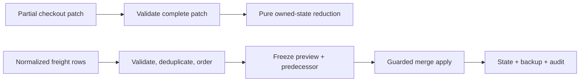

# WooCommerce Checkout and Freight Engineering

A consolidated engineering case covering partial checkout state and guarded freight-configuration changes.

**Technical showcase · Original runnable mechanism demo · Anonymized**

PHP 8.2+ | WooCommerce integration concepts | Deterministic state transitions

## What is runnable here

This public repository includes newly authored, dependency-free PHP code demonstrating two related mechanisms:

1. a pure partial-checkout request reducer that distinguishes omitted fields from explicit clears, preserves unrelated session state, and cleans up only owned dependent keys;
2. an in-memory freight preview/apply service with strict normalized fixtures, business-key deduplication, integer synthetic charge units, deterministic hashes, a private frozen-plan registry, stale/replay refusal, and success-only backup/audit mutation.

The demo is educational and synthetic. It is not original client code and does not parse real workbooks, integrate with shipping/payment services, or submit checkout/orders.

## Quickstart

```bash
php tests/run.php
php tests/run.php freight
php demo/run.php
```

The optional test argument filters names by substring. No match exits with status `2`.

## Engineering problem

Checkout fragments and partial requests can disagree with persisted session state. Treating an omitted field as empty can silently erase a valid choice, while broad session cleanup can damage unrelated state.

Freight changes have a related state-integrity problem: validation and preview must bind the exact proposed rows to the exact predecessor state. Apply must refuse stale, replayed, or foreign plans and must not create misleading backup/audit evidence when no mutation succeeds.

## Demonstrated contracts

- Full patch validation before checkout state transition.
- Omission versus explicit `null` clear using field-presence semantics.
- Owned-key cleanup without rebuilding the session.
- Exact freight fields/types and cross-field validation.
- IDs retained as strings, including leading zeroes.
- Business key `(zone_id, service_code)` and fail-closed duplicate handling.
- Deterministic lexical ordering and SHA-256 content identity.
- Explicit **merge-only** reconciliation; no hidden replace/delete behavior.
- Opaque single-use plans backed by a private in-memory registry.
- Predecessor check before state, backup, or audit changes.

## Architecture at a glance



## Code map

- [`src/CheckoutStateReducer.php`](src/CheckoutStateReducer.php) — pure request/state transition.
- [`src/FreightPlanService.php`](src/FreightPlanService.php) — freight validation, preview registry, hashing, guarded merge, backup, and audit.
- [`tests/run.php`](tests/run.php) — focused dependency-free regression suite.
- [`demo/run.php`](demo/run.php) — successful flows and caught stale/replay failures.
- [Mechanism contracts](docs/mechanisms.md) — schemas, protocol, trust boundary, failure matrix, and production adapter responsibilities.
- [Engineering decisions](docs/engineering.md) — why the boundaries matter.
- [Scope and evidence boundaries](docs/scope.md) — what this public artifact does and does not establish.

## Evidence and delivery boundary

The broader case remains private. This repository combines anonymized technical documentation with a fresh public mechanism demo designed to make selected state-management decisions reviewable. Passing local tests establishes only the behavior of this in-memory demo; it is not evidence of a production database transaction, a completed real-store import, or an order/payment submission.

> Original source, identities, business data, workbooks, actual rates, domains, paths, visual assets, and deployment details are intentionally omitted.
