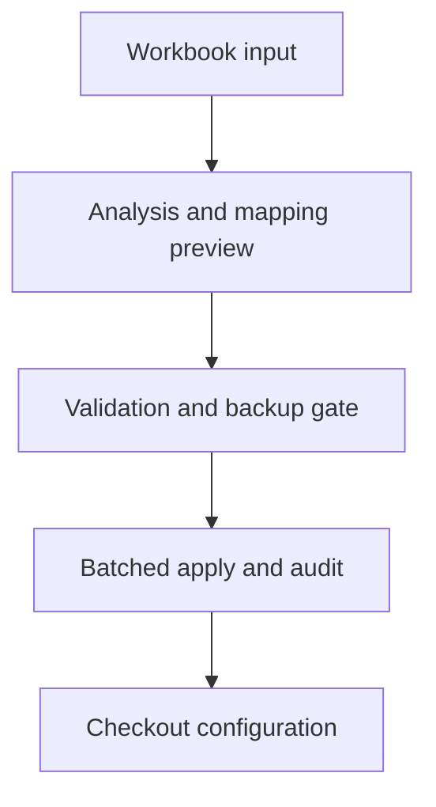

# WooCommerce Checkout and Freight Engineering

A consolidated engineering case covering asynchronous checkout behavior and a guarded workbook-to-freight data pipeline.

**Technical showcase · Documentation only · Anonymized**

WordPress | WooCommerce | PHP | JavaScript | MySQL | XLSX

## Engineering problem

Checkout fragments, partial requests and session values can disagree about the active state. Freight data adds a separate operational concern: an import should be previewable and recoverable before it changes the configuration used by checkout.

## Implementation scope

- Preserved checkout field schemas and synchronized state-dependent headings across asynchronous fragment updates.
- Distinguished omitted request fields from explicit clearing, retained delivery state and limited cleanup to owned session keys.
- Built a workbook analysis and preview workflow with mapping checks before applying freight configuration.
- Implemented explicit reconciliation modes, business-key deduplication, batch staging, row-hash checks, backups and audit events.
- Used an environment-gated quarantine layer to suppress WordPress-level mail, outbound HTTP and background jobs during isolated staging work.

## Architecture at a glance

The following is an illustrative technical flow, not a client screenshot or a deployment topology.

## Evidence and delivery boundary

Implemented checkout remediation and freight-import candidate; the inspected evidence has different validation depths for each module.

Recorded local regression evidence covers PHP checkout callbacks, generated JavaScript heading synchronization and PHP syntax. Freight-import source includes staged apply and verification mechanisms; those checks do not establish a completed real-store import or order submission.

## Read more

- [Engineering decisions](docs/engineering.md)
- [Scope and evidence boundaries](docs/scope.md)

> This repository describes verified implementation work at a technical level. Original source, identities, business data and visual assets are intentionally omitted. It is not an installable application or a claim that the original private implementation is open source.
